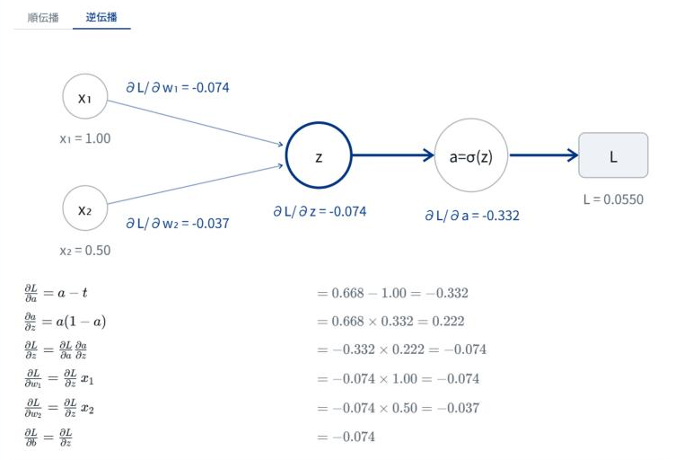

# E資格 動く数式ノート

<p class="about-work-links">
<a class="arrow-link" href="https://minnanosaiban.github.io/e-shikaku/" target="_blank" rel="noopener"><i class="bi bi-box-arrow-up-right"></i> 公開サイト</a>
<a class="arrow-link" href="https://github.com/minnanosaiban/e-shikaku" target="_blank" rel="noopener"><i class="bi bi-github"></i> GitHub</a>
</p>

E資格（JDLA Deep Learning for ENGINEER）の範囲を、**数式の要点**と、**数式・図・数値が連動して動く図**でまとめたノートです。試験直前の見直しに使えるよう、文章は短く、式を中心にしています。式を眺めて分からなかったところは、スライダーを動かして確かめられます。サーバーはなく、静的ファイルを GitHub Pages に置いているだけです。

このページは、その仕組みと、作るうえで判断したことの解説です。公開している範囲は、まだ一部です（末尾の「限界と使うときの注意」を参照）。

## 何を作ったか

{width="700"}

1つのニューロン（シグモイドと二乗誤差）の逆伝播です。

- **図**：順伝播の値は灰色、逆伝播で流れる勾配は紺で表示します
- **数式の行**：左が式、右がその式に値を代入した計算です。行にマウスを乗せると、図の対応する辺とノードが光ります
- **スライダー**：$x_1$・$w_1$・$t$ などを動かすと、図も式の数値も同時に変わります

たとえば正解 $t$ を出力 $a$ に近づけると、すべての勾配が 0 に近づきます。「誤差がなければ学習は進まない」ことを、式を見るだけでなく、手を動かして確かめられます。

## 方針：解説本にしない

もとは、E資格（2022#1）の受験時の勉強ノートを、Qiita の記事（数学編・機械学習編・深層学習編）にまとめたものです。そこから作り直すにあたり、まず**何を作らないか**を決めました。

| | 解説本型 | **動くまとめノート型（採用）** | 実験室型 |
|---|---|---|---|
| 中心 | 文章の説明 | 数式の要点＋動く図 | 動く図 |
| 文章 | 多い | 短い | ほぼなし |
| 今の記事との関係 | 大幅に書き足す | 凝縮した形は保つ | 別物になる |

E資格の解説本や問題集、無料の教材は、すでにたくさんあります。同じ土俵で戦うより、試験直前に1ページで見直せる**凝縮ノート**という形を残し、**文章を増やす代わりに、式を動かせるようにする**ことにしました。

元の記事からは、次のように改良しています。

- 他サイトから引用していた図は使わず、**自作のＳＶＧと動く図に置き換える**
- 複数の記事に散らばっている同じテーマは、1ページにまとめる
- 記号を統一する（損失は $L$、第 $l$ 層の総入力は $\mathbf{u}^{(l)}$、など）
- 数式を見直し、誤りを直す
- キーワードにあるのに本文がなかった項目を補う

## 全体の構成

MkDocs Material で作っています。数式は KaTeX で、動く図は素の JavaScript で描きます。フレームワークは使っていません。

```
docs/
  dl/                  深層学習のページ（Markdown）
  css/note.css         スタイル（動く図の色も含む）
  js/katex-init.js     数式の描画（KaTeX）
  js/widgets/
    core.js            動く図の共通部品
    gate.js            計算グラフの1ノード
    neuron.js          1つのニューロンの順伝播・逆伝播
    vanishing.js       勾配消失
    activation.js      活性化関数 f(x) と f'(x)
    temperature.js     温度つきソフトマックス
```

ページには、図を置く場所だけを書きます。

```html
<div class="ew" data-widget="neuron"></div>
```

各 `widgets/*.js` は、名前を付けて図の描き方を登録します。ページを開いたとき、`core.js` が `data-widget` の名前に合う図を探して、その場所に描きます（MkDocs Material のページ遷移にも対応しています）。

```js
ENote.register("neuron", (el) => { /* 図・数式の行・スライダーを作る */ });
```

## 数式の行と図を結ぶ

動く図で一番大事にしたのは、**「数式の1行 ⇄ 図の要素 ⇄ 数値」の対応**です。図の要素に `data-k` という印を付け、数式の行には「光らせる要素の印」を渡します。

```js
// 図の要素（辺・ノード）に印を付ける
svg.append(E.s("line", { "data-k": "e3", ... }));
// 数式の行：左が式、右が代入した計算、hl が光らせる要素
{ tex: "\\frac{\\partial a}{\\partial z}=a(1-a)",
  num: "=" + f(a) + "\\times" + f(1 - a) + "=" + f(dad),
  hl: ["e3", "na"] }
```

行にマウスを乗せる（またはフォーカスする）と、`core.js` が `data-k` の一致する要素に `ew-hl` というクラスを付けます。図の色や太さはＣＳＳだけで決まり、JavaScript は色を知りません。ダークモードへの切り替えにも、そのまま対応できます。

どの図も、状態は**スライダーの値だけ**で、値が変わるたびにＳＶＧと数式の行を**まるごと描き直します**。描くものは数十個の要素なので一瞬で済み、その代わり「画面だけが先に変わって、数値と食い違う」不具合が起きません。

## 数値の検算

動く図の数値が間違っていては意味がないので、公開前に次を確かめています。

- **導関数**：活性化関数7種の導関数を、数値微分（$\dfrac{f(x+h)-f(x-h)}{2h}$）と比べ、一致することを確認しました
- **表の値**：ＧＥＬＵ・Swish の値域や、導関数の最大値（約 1.13・約 1.10）は、細かく刻んだ計算で求めた値と照合しました
- **ソフトマックス**：温度 $T$ を小さくしても桁あふれしないよう、**最大値を引いてから指数をとります**（結果は同じです）。スライダーを端まで動かしても、`NaN` や `Infinity` が出ないことを確かめています

## 元の記事の誤りを直す

元の記事の式を、そのまま信用していません。移すときは、形（次元）の検算と、教科書の定義との照合を行います。たとえば、Affine（全結合層）のバイアスの勾配です。

$$
\mathbf{Y}=\mathbf{X}\mathbf{W}+\mathbf{b}\qquad\Rightarrow\qquad
\frac{\partial L}{\partial \mathbf{b}}=\sum_{n=1}^{N}\left(\frac{\partial L}{\partial \mathbf{Y}}\right)_{n,:}
$$

元の記事では、この勾配が $\partial L/\partial \mathbf{Y}$ のままでした。バイアス $\mathbf{b}$ は全サンプルに同じ値が足されている（ブロードキャスト）ので、逆伝播ではサンプルの方向に**和をとる**必要があります。形で確かめると、$\mathbf{b}$ は $M$ 個、$\partial L/\partial \mathbf{Y}$ は $N\times M$ で、そのままでは合いません。

## デザイン

見た目は、このサイトの決めごと（紺 1 色と無彩色のグレー、罫線より余白）に合わせました。色は **紺（`#003682`）とグレーだけ**で、色付きの枠やアイコンは使いません。動く図の中の色にも、意味を持たせています。

| 要素 | 色 |
|---|---|
| 順伝播の値・通常の要素 | 灰色 |
| 逆伝播の勾配・注目させたい値 | 紺 |
| 数式の行に対応して光る要素 | 紺の太線 |
| 棒グラフ | 灰色（光ったものだけ紺） |

最初は、複数の色で塗り分けた派手な版を作りましたが、見づらく、好みでもなかったため、色を絞って作り直しました。

## 限界と使うときの注意

- **公開しているのは、一部のページだけです。** 深層学習の「誤差逆伝播法」と「活性化関数」の2ページで、数学・機械学習・深層学習の全範囲を順に追加していく予定です
- 数式は、元の記事や教科書と照合して直していますが、**誤りが残っている可能性があります。** 試験に使うときは、公式の教材でも確かめてください
- 動く図の数値は、小さな例（1つのニューロン、3クラスなど）での計算です。実際のネットワークの値ではありません
- スマートフォンでは、横に長い表が表の中で横スクロールになります
- 自動テストはなく、確認はブラウザで行っています
